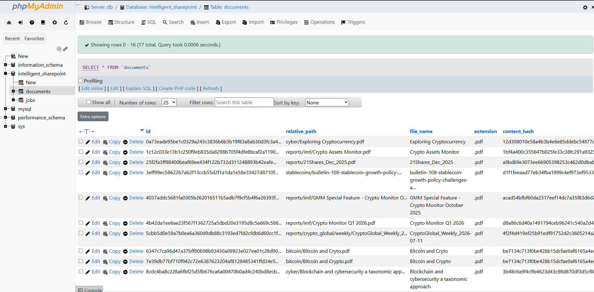
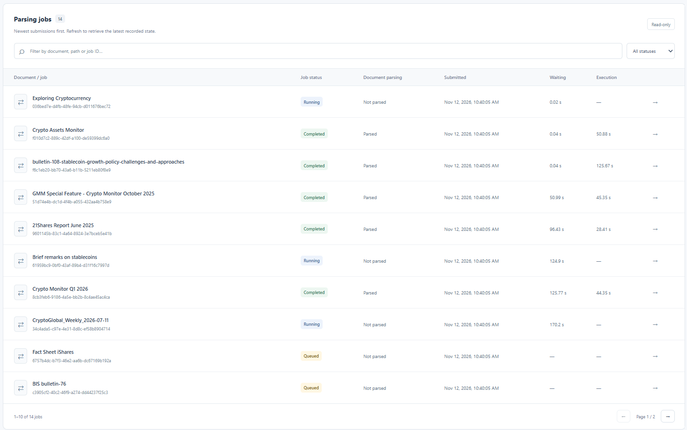
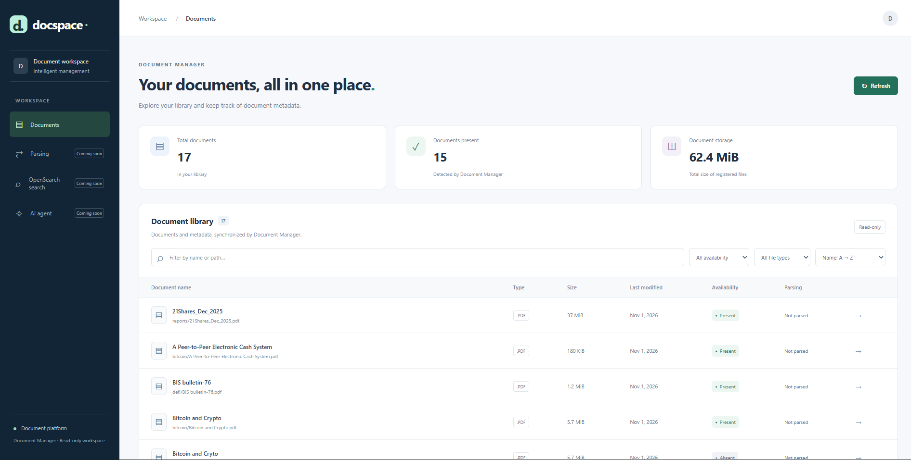
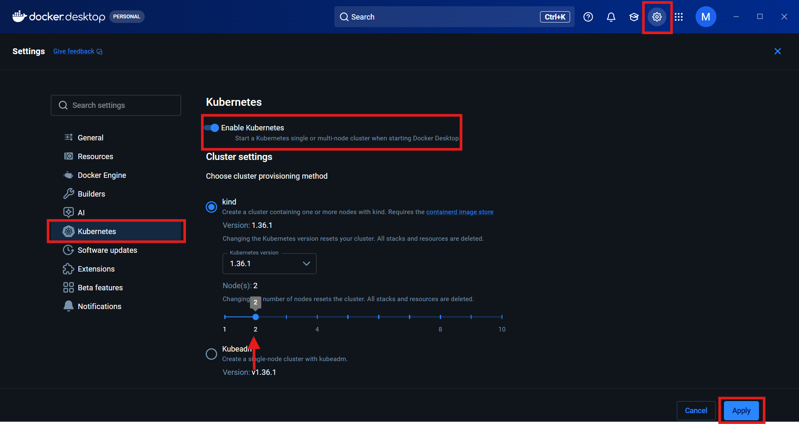

# Docspace: Document Management Platform (Under Construction 🚧)
Docspace is a personal project I'm building to explore document processing, microservices, and container orchestration.

The idea is simple: upload and manage documents, automatically parse their content, and make the results available through a web interface. The backend is built with Python and FastAPI, while Docker and Kubernetes are used to manage the different services and scale the parsing workers.

## Document Manager Service (MySQL and APScheduler)
The Document Manager is responsible for keeping track of documents and their processing status.

It uses FastAPI to expose the API endpoints, MySQL to store document metadata and parsing jobs, and APScheduler to run background tasks.
The scheduler periodically scans the document directory, detects new or missing files, submits documents for parsing, and updates their status in the database.

## SQL DB Service
MySQL stores information about documents and their parsing jobs, including processing status, execution times, errors, and extracted content.

### Optional : phpMyAdmin
For development and debugging, phpMyAdmin provides a simple way to inspect the database without writing SQL queries manually.

<div style="text-align: center;">
    
</div>

## Parsing Service (Docling, OpenRouter and Redis Queue)

The Parsing Service handles the actual document processing.
It uses Docling to convert PDF documents into structured Markdown, with a vision-language model accessed through OpenRouter.
Parsing jobs are managed using Redis Queue (RQ), allowing the API to submit jobs without waiting for the parsing process to finish.

The service is split into two components:

- **Parsing API**: receives parsing requests, adds jobs to Redis, and exposes their status.
- **Parsing Workers**: consume jobs from the queue, process documents, and save the extracted Markdown content.

Since document parsing can be relatively expensive, the workers are designed to run as multiple replicas using Kubernetes.
This separation also keeps the API lightweight, while the heavier Docling dependencies are only installed in the workers.

<div style="text-align: center;">
    
</div>

## Graph-RAG Service (Cognee, OpenRouter, Neo4j)
Available soon. This service will leverage Cognee and OpenRouter for processing, and Neo4j for graph-based storage and retrieval of document relationships.

## AI-Agents Service
Available soon. This service will leverage AI agents to automate workflows, interact with the document management system, and perform tasks based on user instructions.

## Frontend Application (Codex)
The frontend is an Angular and TypeScript application designed to provide a modern interface for document management.

This application is entirely developed by **OpenAI Codex**, allowing me to focus on the Python backend and infrastructure while leveraging AI-assisted development for the frontend.

Codex was given the following instructions:
- Build a modern and responsive Angular application.
- Integrate the existing FastAPI endpoints.
- Keep all frontend code strictly within the app/ directory.
- Do not modify the backend, Docker configuration, or other services.
- Submit all frontend changes through a dedicated GitHub Pull Request for review.

<div style="text-align: center;">
    
</div>

## Installation

### Requirements
The project is designed to run locally with Docker Desktop.

Requirements are:
- Git
- Docker Desktop with Docker Compose.
- (Optional) Kubernetes, enabled directly through Docker Desktop:

<div align="center">
  
</div>

### Running the Project (Locally with Docker Compose)
1. **Clone the repository:**

   ```bash
   git clone https://github.com/Lahdhirim/RAG_GENAI-docspace-microservices.git docspace
   cd docspace
   ```

2. **Add your PDF documents to `data/bronze/`.**

   You can use any folder structure. The document manager scans subdirectories automatically.

   ```text
   data/bronze/
   ├── reports/
   │   └── annual-report.pdf
   └── research/
       └── paper.pdf
   ```

3. **Create a `.env` file using `.env.example` as a template.**

   Fill in the required values, including your VLM API key under `PARSING_MODEL_API_KEY`.

   The current implementation uses **OpenRouter**. Support for other providers exposing an OpenAI-compatible API is planned.

4. **Build and start the application:**

   ```bash
   docker compose up --build -d
   ```

   The initial build and startup typically take around **three minutes**, depending on your machine, internet connection and Docker cache.

5. **Open the application at http://localhost:4200.**

#### Persistent Data

Original documents and generated Markdown files are stored in your local `data/` directory. Database and Redis data are stored in persistent Docker volumes.

To stop the application while preserving your data:

```bash
docker compose down
```

To start it again in a later session:

```bash
docker compose up -d
```

Previously completed parsing results remain available, so unchanged documents do not need to be parsed again.

> **Warning:** `docker compose down -v` deletes the named volumes, including the database and Redis data. Your local `data/` directory remains intact, but losing the database records can cause documents to be parsed again.

### Running the Project (Kubernetes Clusters)
Available soon. Instructions for deploying the project on Kubernetes clusters will be provided here. This will include setting up the necessary Kubernetes resources, configuring persistent storage, and managing the application lifecycle within a cluster environment.

